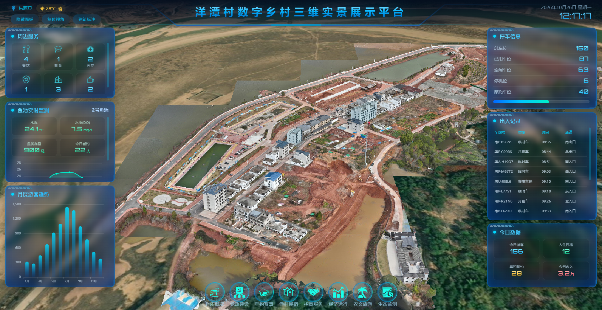
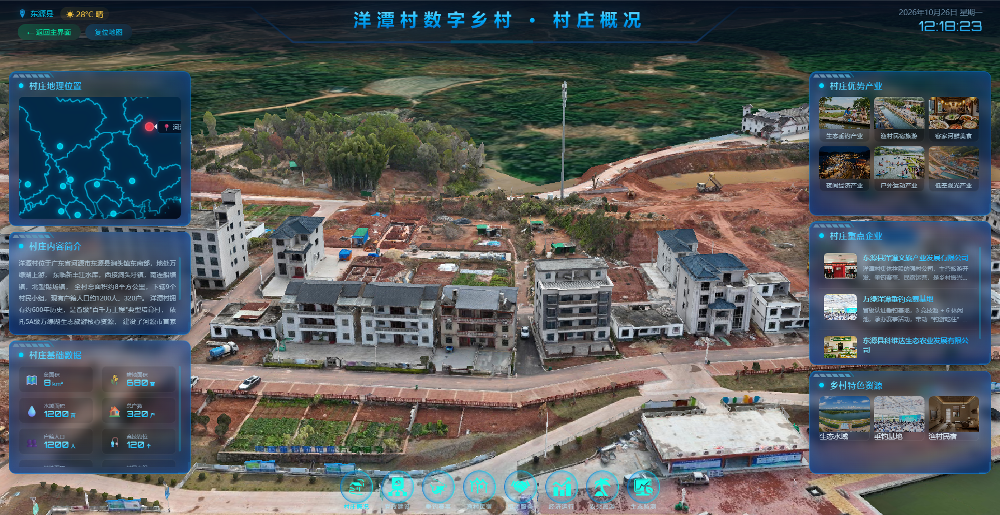

# 洋潭村数字乡村三维实景展示平台 (Yangtan Village Digital Village 3D Platform)

[](https://opensource.org/licenses/MIT)
[]()
[]()
[]()

> 一个基于三维实景（WebGL）与数据可视化的数字乡村综合管理大屏系统，助力乡村振兴与智慧农业。

## 📖 项目简介

**洋潭村数字乡村三维实景展示平台** 旨在通过数字孪生技术，将乡村的地理风貌、基础设施、农业资源及文旅数据进行直观、立体的呈现。系统采用 3D 倾斜摄影实景模型作为底座，融合了物联网实时监测数据、安防出入数据、文旅运营数据，为乡村治理、招商引资、农文旅融合发展提供全面、实时的数据支撑。

## 📸 界面预览




## ✨ 核心功能

### 1. 🌍 三维实景底座 (3D GIS)
*   **实景展示**：高精度还原洋潭村地形地貌、水系、建筑与道路。
*   **交互操作**：支持隐藏面板、复位视角、建筑标注等快捷操作。
*   **全维导航**：底部提供村庄概况、党政建设、垂钓赛事、渔村民宿、招商服务、经济运行、农文旅、生态监测等模块入口。

### 2. 📊 运营数据看板 (Data Dashboard)
*   **周边服务**：统计展示餐饮、教育、医疗等公共服务设施数量。
*   **今日数据**：实时汇总今日游客量、民宿入住数、垂钓预约数与今日总收入（如：156人 / 12间 / 28场 / 3.2万元）。
*   **月度游客趋势**：动态图表展示全年各月游客量波动趋势。

### 3. 🐟 智慧农业与生态监测 (IoT Monitoring)
*   **鱼池实时监测**：接入水质传感器，实时显示水温（23.2℃）、水质DO（7.6 mg/L）、鱼类存量及今日垂钓人数。
*   **生态监测**：联动底层生态监测模块，保障乡村水域生态平衡。

### 4. 🚗 智慧安防与交通 (Smart Traffic & Security)
*   **停车信息**：实时统计总车位、已用车位、空闲车位及摩托车位数据。
*   **出入记录**：接入车辆识别系统，动态滚动展示车牌号、车辆类型（临时车/赛事车辆/月租车）、时间及出入通道（南入口/北入口等）。

## 🛠️ 技术栈 (建议/参考)

*   **前端框架**：Vue 3 / React 18
*   **三维渲染**：Three.js / Cesium / 基于 WebGL 的 3D 引擎
*   **图表可视化**：Apache ECharts / DataV
*   **UI 组件库**：Element Plus / Ant Design (深色主题定制)
*   **状态管理**：Pinia / Vuex
*   **构建工具**：Vite / Webpack

## 🚀 快速开始

### 1. 克隆项目
```bash
git clone https://github.com/your-username/yangtan-village-3d.git
cd yangtan-village-3d
```

### 2. 安装依赖
```bash
npm install
# 或者
yarn install
```

### 3. 启动开发服务器
```bash
npm run dev
# 或者
yarn dev
```

### 4. 打包构建
```bash
npm run build
```

## 📂 目录结构 (参考)

```text
├── public/                 # 静态资源
├── src/
│   ├── assets/             # 图片、字体、全局样式
│   ├── components/         # 公共组件 (如卡片、图表封装)
│   ├── views/              # 页面视图 (如大屏主页面)
│   ├── three/              # 三维场景相关代码 (模型加载、交互)
│   ├── api/                # 数据接口请求
│   ├── store/              # 状态管理
│   ├── App.vue             # 根组件
│   └── main.js             # 入口文件
├── package.json
└── README.md
```

## 🤝 贡献指南

欢迎提交 Issue 或 Pull Request！
1. Fork 本仓库
2. 创建您的分支 (`git checkout -b feature/AmazingFeature`)
3. 提交您的更改 (`git commit -m 'Add some AmazingFeature'`)
4. 推送到分支 (`git push origin feature/AmazingFeature`)
5. 打开一个 Pull Request

## 📄 许可证

本项目基于 [MIT](https://opensource.org/licenses/MIT) 许可证开源。

---
*注：本项目 UI 参考洋潭村数字乡村展示平台设计图，如有涉及真实业务数据，均为脱敏后的模拟数据。*
